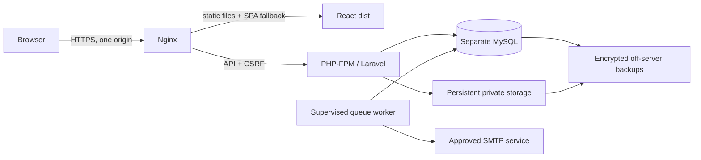

# Phase 6A — production readiness and deployment guide

Audit date: 25 October 2026. **No hosting was provisioned, no deployment or GitHub push was made, no existing database was migrated, and the local `.env` was not changed or printed.** These instructions describe future owner-approved actions, not actions already performed.

## 1. Architecture and hosting decision

Recommended capstone starting point: one small Linux VPS, one HTTPS origin, Nginx, PHP-FPM, a supervised Laravel queue worker, and a **new, separate MySQL database**. Serve compiled React files directly; route `/api/*` and `/sanctum/*` internally to Laravel's front controller. Node is a build tool, not a production web server. XAMPP, Vite's development proxy, `vite preview` and `php artisan serve` are not the production architecture.



| Option | What must run | Cost/operational tradeoff |
| --- | --- | --- |
| Single VPS, colocated MySQL | Nginx + PHP-FPM + worker + MySQL + persistent disk; distinct staging/production DBs and users | Lowest practical cost; owner maintains OS, PHP, MySQL and backups. Single point of failure. Recommended only for a small capstone with someone responsible for operations. |
| VPS + managed MySQL | Same app server; provider-operated private/TLS database | Higher cost; easier database backups/patching. Still maintain the app server and private file backups. Preferable if budget permits. |
| Managed app/container platform + managed MySQL + private object storage | Static frontend, PHP container, separate worker, durable DB/storage, same-origin routing or approved sibling subdomains | Less OS maintenance, but more services and billing. MySQL/object-storage adapters and container/runtime setup require additional staging work. |

As an illustrative researched provider, DigitalOcean lists a 2 GiB/1 vCPU VPS at **US$12/month** and 4 GiB/2 vCPU at **US$24/month**. Weekly VPS backups add 20%, daily 30%. These are vendor list prices, not a purchase or guaranteed total. [VPS pricing](https://www.digitalocean.com/pricing/droplets), [backup pricing](https://www.digitalocean.com/pricing/backups).

Start sizing at 2 GiB RAM, 1–2 vCPU and 25–50 GiB durable SSD for a low-traffic trial, then measure PDF concurrency, memory and database load. This sizing is an engineering estimate, not a capacity guarantee. A US$12 VPS plus weekly image backup is US$14.40/month before domain, SMTP, off-server logical/file backups, taxes and currency conversion. Budget roughly **US$15–30/month** for a small self-managed trial depending on extras. Managed MySQL currently starts around **US$15.15/month**, with storage/options to confirm at checkout; a VPS + managed DB therefore needs a higher budget, roughly **US$30–45+** with extras. [Managed database pricing](https://www.digitalocean.com/pricing/managed-databases).

Managed platforms should be compared on the *whole* API + worker + MySQL + disk bill. Render documents idle suspension after 15 minutes for free web services and ephemeral filesystems; it supports custom MySQL on a paid persistent disk, rather than supplying this project's MySQL through its managed Postgres service. A free static frontend alone cannot run Laravel or MySQL. [Free service limits](https://render.com/docs/free), [Render service types](https://render.com/docs/service-types), [persistent disks](https://render.com/docs/disks). Platform defaults on unrelated domains are unsuitable for this Sanctum cookie design: prefer the single-origin layout, or approved frontend/API subdomains sharing one registrable domain. [Sanctum SPA authentication](https://laravel.com/docs/12.x/sanctum).

Select a nearby available region with acceptable latency from the Philippines, understand data location, and obtain owner approval of provider, plan, recurring budget, region and domain **before** provisioning anything. No service has been selected or purchased.

## 2. Server/runtime requirements — blocking PHP issue

The inspected local CLI is **PHP 8.2.12**. It must not be used as the public server runtime. PHP's 21 October 2026 advisory identifies critical unauthenticated RCE vulnerabilities and fixes in **8.2.35 / 8.3.36 / 8.4.27 / 8.5.12**. Use a fully patched supported branch (recommend current patched PHP 8.4 for the first staging compatibility run), or obtain documented vendor backport evidence. Application tests do not fix native runtime vulnerabilities. [Official security advisory](https://www.php.net/archive/2026.php).

PHP also advises disabling `session.upload_progress.enabled` at server configuration level pending the next relevant fixes. Apply the reviewed `deploy/php.ini.example` to the actual web-server/FPM configuration and restart workers; it is not a Laravel `.env` setting. Do not use configuration mitigations as a substitute for patching. PHP 8.2 security support ends 31 December 2026; recheck lifecycle/advisories for every release. [Supported PHP versions](https://www.php.net/supported-versions.php).

Requirements:

- Supported, patched Linux OS, Nginx and PHP-FPM; Composer 2. Installed Laravel is 12.69.3 with PHP constraint `^8.2`.
- Native PHP extensions: ctype, curl, DOM, fileinfo, filter, hash, mbstring, OpenSSL, PDO/pdo_mysql, session, tokenizer and XML. zlib/iconv and OPcache should be available; `pcntl` is useful for production queue signals/timeouts on Linux. Re-run `composer check-platform-reqs --no-dev` on the selected runtime. Some Composer checks pass locally via polyfills; the readiness command also checks native extensions.
- MySQL 8.x with InnoDB, utf8mb4, timezone behavior checked against the app's Asia/Manila dates. Do not substitute MariaDB/Postgres without a separate compatibility test.
- Node 24 was used for the local build. Use a supported Node release compatible with the locked Vite 8 dependency; install with `npm ci` from the lockfile.
- Dompdf 3.1.6 and bundled DejaVu fonts already exist in Composer. No paid renderer or browser binary is required by production PDF export.
- Persistent protected `backend/storage` (especially `app/private`) and a stable application key. Framework cache/views/logs and `bootstrap/cache` must be writable by the application account; source/vendor/config files should not be web-writable. Never use blanket `chmod 777`.
- Limit initial PHP-FPM concurrency and concurrent PDF work to fit RAM; start with a measured small pool. The example uses a 60-second request/worker timeout and 90-second queue retry interval. Benchmark with realistic synthetic documents before raising these limits.

## 3. Environment variables and secrets

Review `backend/.env.production.example` and root `.env.production.example`. They deliberately contain blank domains, credentials and keys. Fill copies in the future environment's secret manager or protected environment file; **do not replace the current local `.env`**. Real staging and production need different databases, users, keys, cookies, mail settings, storage and hostnames.

| Group | Required configuration |
| --- | --- |
| Application | `APP_ENV=production`, `APP_DEBUG=false`, generated stable `APP_KEY`, actual HTTPS `APP_URL` and `FRONTEND_URL`, `APP_TIMEZONE=Asia/Manila` |
| Frontend | `VITE_API_URL=/api` for same-origin hosting; optional owner-approved `VITE_SUPPORT_EMAIL`. Vite embeds these at build time. **Every `VITE_*` value is public.** Rebuild when changing them. |
| Cookies | Database sessions, Secure + HttpOnly, SameSite=lax, path `/`, `SESSION_ENCRYPT=true`. For same-origin, leave domain `null` (host-only). Use a distinct cookie name for staging. |
| Sanctum/CORS | `SANCTUM_STATEFUL_DOMAINS` = real frontend host (and port if needed), **without** scheme/path/wildcard; `CORS_ALLOWED_ORIGINS` = exact `https://...` browser origin(s), no wildcard or regex. Keep credentials enabled. |
| Proxies | Empty `TRUSTED_PROXIES` for direct Nginx TLS; otherwise only documented provider proxy IPs/CIDRs. Never trust `*` or client-controlled forwarded headers. |
| Database | Dedicated non-root `DB_USERNAME`, strong secret `DB_PASSWORD`, new `DB_DATABASE`, correct `DB_HOST`; `DB_URL` blank unless deliberately managed. Remote managed DB requires provider CA via `MYSQL_ATTR_SSL_CA`, private networking/firewall and certificate validation. |
| Cache/queue | `CACHE_STORE=database`, `QUEUE_CONNECTION=database`; same persistent database-backed rate-limit/cache/session state across workers. `PASSWORD_RESET_QUEUE_CONNECTION=database`, queue `password-resets`. Optional admin mail uses `notifications`. |
| Private files | `RESUME_DISK=local` with persistent private storage and automatic serving disabled. Do not use the `public` disk or `storage:link` for resumes. Multiple app instances would require a shared private disk/object store. S3 needs the compatible Flysystem AWS adapter and private bucket configuration, which were not added or tested here. |
| Logs | `LOG_CHANNEL=daily` or `stderr`, `LOG_LEVEL=warning`, bounded retention. No request bodies, cookies, tokens, SQL bindings or reset-query URLs in public logs/APM. Production exception reports now record only exception class. Worker output, failed-job diagnostics and proxy errors still require restricted access and retention. |
| Mail | Approved sender and working SMTP/API transport; fill host, scheme/port and credentials from the provider. `log`/`array` are development-only. Choose `smtps:465` or the provider's STARTTLS SMTP settings accurately; don't guess credentials or domains. |

Run `php artisan pwdwork:production-check` on the **actual environment**. It prints requirement labels and PASS/FAIL, not secrets, and does not connect to the database/mail/hosting or apply migrations. Exit 1 means a check failed. The local development configuration intentionally fails production checks, including the PHP patch requirement. A pass is only a static configuration gate: validate live TLS, connectivity, mail, workers, backups, policies and real browser behavior separately. Vendor-backported runtime fixes need manual evidence because the version-floor check cannot recognize backports.

Keep `APP_KEY` consistent across API and worker releases and back it up separately: sessions and new private mail queue commands are encrypted with it. Blindly generating a new key on each deployment breaks decryption. Old queued plaintext jobs remain readable by Laravel, but new encryption does not retroactively protect historical jobs/failed-job records. Manage those under an approved retention policy, not a destructive cleanup during this audit.

## 4. Database setup and safe migrations

**Phase 6A adds no migrations.** All 15 existing migrations were reviewed. Their upgrade paths create/add tables/columns/indexes; no row-conversion update is present. Existing application/profile records are preserved by additive upgrades. Rollback/down methods can drop data and are not a safe routine upgrade strategy.

Relevant integrity features include unique applicant/job applications and saved jobs; unique user/profile/company relations; indexed publication/moderation status; unique complaint fingerprints and request idempotency keys; request/message/event foreign keys; indexed participant histories; versioned resume JSON; unique application snapshot; and indexed applicant modification dates. Accommodation/audit/report restrictions intentionally prevent casual deletion. Session `user_id` is indexed rather than constrained by a foreign key; account suspension and password reset explicitly revoke database sessions/tokens. Do not add cascade deletion casually.

For a **new** owner-approved staging/production environment:

1. Create an empty database and a restricted application account using your provider's protected admin tools. Use a separate migration credential with DDL permissions during upgrades; runtime should have only necessary access. Never expose MySQL to arbitrary public IPs.
2. Supply its environment through the new secret store. Check the target connection carefully without posting credentials or configuration dumps into chat/logs.
3. Review `php artisan migrate:status` and `php artisan migrate --pretend` on that new target. Do not use `--isolated` on a fresh database before its database cache/lock tables exist.
4. After confirming the target and approving the SQL, run `php artisan migrate --force` **once on that new environment**. Do not run this against the existing local database as part of this guide. Avoid automatic migrations in every web instance's startup script.
5. Never run `db:seed`, import `backend/database/sql/pwdwork.sql`, copy local MySQL records, or upload local private storage to public hosting. Both demo-seeder entry points now refuse non-local/non-testing environments. Production begins empty.
6. Provision the first real administrator using `php artisan pwdwork:provision-admin`, supplying its prompted values privately. Do not seed shared/default administrator credentials. The standard accommodation catalog is defined in code; job/profile workflows create needed labels without the demo seeder.

For a **later upgrade** of an existing staging/production database: take and restore-test a backup, inspect pending migrations and the exact release diff, stop writes/worker consumption if necessary, review `--pretend` SQL, and apply only reviewed migrations once. Previous Phases 4/5 may still be pending locally; use their individual setup guides if you later choose to upgrade local MySQL. No local migration status or mutation was needed in this audit.

MySQL DDL is not generally undone by application transactions. A failed multi-table migration may leave partial schema. Investigate and forward-fix in staging; never rerun blindly, reset the DB, or drop tables containing records. Confirm migration ledger + actual schema, and use pre-upgrade backup recovery only with explicit approval.

## 5. Build and packaging commands

Run from a clean release checkout, with the approved frontend build variables present:

```sh
npm ci
npm run lint
npm run build
cd backend
composer install --no-dev --prefer-dist --no-interaction --optimize-autoloader
composer check-platform-reqs --no-dev
php artisan config:cache
php artisan route:cache
php artisan view:cache
php artisan pwdwork:production-check
```

Do not use `composer update` during release installation. Build/test with dev dependencies in CI; production runs the lockfile without dev packages. The frontend output is `dist/`, independent of Laravel's skeleton `resources` Vite files. Deploy `dist` as the release's frontend directory plus the backend source/vendor required by Laravel. Exclude `.git`, local `.env`, `node_modules`, test fixture databases, SQL dumps, browser profiles, logs, the ignored PDF-inspection Python libraries and other local records. Do not deploy the repository itself as a public document root.

Cache configuration only after the target environment is supplied. Configuration caching can embed secrets, so `bootstrap/cache` is private. For a configuration correction, rebuild the config cache on that release; don't repeatedly clear shared application cache/rate-limit state on a live service. Never run tests using production `.env` or production credentials.

## 6. Security and privacy checklist

- Keep Sanctum stateful CSRF protection enabled. Axios obtains `/api/csrf-cookie`; login/register/logout must use the configured first-party origin and HttpOnly session. Protected routes remain role-scoped; applicant/company ownership and version/consent checks are enforced on the server.
- General API exceptions now hide traces/model/SQL/file details even when debug is accidentally enabled. Validation remains useful, rate-limit headers remain intact, and domain conflict/validation explanations remain available. Responses use private/no-store, nosniff, no-referrer and SAMEORIGIN headers.
- Coarse shared API throttling is 180 requests/minute by account or IP, alongside existing stricter login, registration, recovery, reporting, request and PDF limits. This is not DDoS protection; load-test legitimate traffic and add provider-level protections as needed.
- Passwords remain hashed; byte-length validation avoids bcrypt truncation/runtime errors. Cookie logout safely handles an incidental bearer header. Password reset/suspension retain token and session revocation. No token is stored in browser localStorage.
- Frontend user text uses React escaping; PDF/HTML use escaped Blade. Dynamic SQL values are bound and filter/sort choices constrained. Remote PDF resources, PHP and PDF JavaScript stay disabled. PDFs remain private authenticated downloads.
- Employers can access builder resumes only as explicit, unrevoked snapshots for their own applications. Profile accommodations have separate consent, discussions have participant scopes, and withdrawn requests block employer access. A previously downloaded or viewed copy cannot be recalled.
- The earlier uploaded-profile-resume workflow remains distinct: professional profile/file information may be visible to employers for applications to their jobs. Owner-approved privacy notice must explain this accurately; it is not the same as new per-application builder snapshot consent.
- Public fake contacts/hotlines, certification badges, unsupported impact counts and employer-accessibility certification wording were removed. A configured real support mailbox may be displayed via `VITE_SUPPORT_EMAIL`. Privacy/terms dialogs explicitly state publication is pending rather than pretending to be complete legal policies.
- Default backend `/` no longer exposes Laravel/PHP welcome-page details. Protect all hidden/config/vendor/storage paths at the web server. Do not enable debug toolbars/Telescope or publish logs, backups, private resumes or the SQL dump.
- Patch runtimes/OS regularly and rerun dependency audits. Passing registries does not cover PHP binaries, database servers, operator misconfiguration or undisclosed vulnerabilities.

## 7. Backup and recovery

Choose an owner-approved retention period and recovery objective. A reasonable capstone proposal is daily encrypted database/private-file backups retained for 7–14 days, plus a pre-upgrade backup. This is a proposal, not a legal retention determination. Store backups off the app server, restrict access, monitor backup success, and test restoration into an empty isolated database/storage set before relying on them. VPS image backups alone are not an application-consistent MySQL backup strategy.

Example Linux logical backup command (review permissions/provider privileges first):

```sh
mysqldump --defaults-extra-file="$BACKUP_CREDENTIALS_FILE" \
  --single-transaction --routines --triggers --events --no-tablespaces \
  --set-gtid-purged=OFF --result-file="$BACKUP_FILE" "$BACKUP_DATABASE"
```

Use a protected defaults file/secret mount rather than putting a password in command arguments or shell history. Use `--result-file` to avoid shell encoding problems on Windows too. Quiesce writes as needed for consistent DB/private-file pairs. Back up private files, the deployed release identifier and configuration/key material separately; encrypt and protect every copy. Never use local applicant records as public seed data.

Restore rehearsal only, to a specifically confirmed empty isolated destination:

```sh
mysql --defaults-extra-file="$RESTORE_CREDENTIALS_FILE" "$EMPTY_RESTORE_DATABASE" < "$BACKUP_FILE"
```

Verify record counts, owned applications, shared/revoked resumes, request privacy, worker decryption and PDF downloads after restoring. Never point this command at a live or local populated database without an approved recovery plan. If a real recovery is required, stop writes, preserve evidence and the failed environment, restore into a replacement target, validate, then switch traffic deliberately. Decide how to reconcile writes made since the backup.

## 8. Deployment procedure after approval

1. Owner approves provider/budget/region/domain, operator identity, support channel, privacy/terms, data retention and whether real users are permitted. Start with access-restricted staging and synthetic accounts.
2. Prepare a patched host/runtime, private new DB, TLS certificate, firewall and limited deployment/application accounts. Only web ports are public; restrict SSH and DB access. Confirm the PHP advisory fixes before exposing the service.
3. Build a versioned release from the approved GitHub commit. No push has been performed here. Prefer a read-only deploy key/token; do not put GitHub or hosting credentials into source. For CI, run lint/build, Composer audit/platform checks, Pint and Laravel tests on an isolated SQLite/throwaway MySQL database; make deployment a separate protected, manual approval job. Never provide production secrets to untrusted pull-request builds.
4. Mount persistent private storage, target-specific `.env`/secret mounts and protected logs. Use the correct non-root account and narrowly scoped write permissions. Keep API and worker on the same release/key.
5. Follow the reviewed migration procedure above, then cache target configuration/routes/views and run the readiness command. A failing gate stops the release.
6. Adapt `deploy/nginx.conf.example` and `deploy/php.ini.example` to the approved host. Replace **every** `${PWDWORK_...}` placeholder, keeping Nginx variables such as `$uri` literal. Validate with `nginx -t` and the host's PHP-FPM configuration test before activation. Templates were not run on this Windows workspace; they require staging validation.
7. Serve React using SPA fallback so direct refresh of `/applicant/resumes`, `/admin` and other routes loads the app. `/api` must reach Laravel, never `index.html`. Missing hashed assets must return 404; retain old hashed assets across deployments so open tabs can load their code chunks. Cache hashed assets for a year and avoid caching `index.html`; never cache authenticated API/PDF responses at a CDN.
8. Configure the reviewed CSP/security headers from the Nginx template. The same-origin policy must allow the sandboxed resume preview and inline style attributes used by the app; validate all forms, dialogs, PDF/blob downloads and navigation with the actual browser policy. TLS termination/proxy headers must match `TRUSTED_PROXIES`. HSTS is for the approved HTTPS host; subdomain-wide policy was not assumed.
9. Adapt `deploy/worker.conf.example` for Supervisor/systemd. Run the database worker with `--queue=password-resets,notifications,default --tries=3 --timeout=60`; retry_after must exceed timeout. Restart workers with each release so they load current code/config. Verify a real reset email. If queue connections differ, run a separate correctly configured worker for each connection.
10. There are currently no business-critical scheduled tasks in `routes/console.php`. If enabling retention pruning or future schedules, add reviewed schedules and a once-per-minute `schedule:run` cron with concurrency controls and the same environment. Do not add automatic private-record deletion as part of deployment. Database cache is lazily expired; define and monitor cleanup of expired sessions/queue artifacts under the retention plan.
11. Run the staging checks below, then require explicit owner approval for public cutover. Use a versioned `current` symlink/release switch, reload PHP-FPM to clear stale code/OPcache, restart worker processes, and keep the previous code/assets available. Do not automatically migrate again on rollback or boot.

## 9. Testing and staging/production verification

Local automated commands:

```powershell
cd backend
php artisan test
php vendor/bin/pint --test app bootstrap config routes tests database/seeders
composer check-platform-reqs
composer audit --locked
cd ..
npm.cmd run lint
npm.cmd run build
npm.cmd audit
node scripts/browser-smoke.mjs
```

Pint excludes generated cache/storage/vendor files through `backend/pint.json`; the full source formatting check passed in this audit. Browser smoke supports `BROWSER_PATH` and alternate API/frontend/debug ports. It creates only a guarded temporary SQLite fixture/profile. Set `PWDWORK_SMOKE_PRODUCTION=1` after building to test the actual `dist` assets via a test-only preview server; this is not a proposed production server. `PWDWORK_SMOKE_PHASE6_ONLY=1` focuses public-content/text/dialog checks; unset focused flags for the full integration run. Native headless keyboard injection requires a documented focused-native-button/form fallback on this Windows machine; manual keyboard verification remains necessary.

Staging checklist (synthetic data only):

- Verify HTTPS, no mixed content, Secure/HttpOnly/SameSite cookies, CSRF failure/success, exact CORS allow/deny, session refresh/logout/expiry, unauthorized role/ownership access and rate-limit behavior behind the real proxy.
- Verify migrations/schema/indexes against actual MySQL, unique constraints, concurrent duplicate applications, version conflicts, moderation transactions and locks/deadlocks. SQLite cannot establish MySQL concurrency/DDL behavior.
- Exercise applicant profile/save/apply, employer verification/publication, administration/report/audit, recommendations, accommodation messages/agreements/withdrawal, resume creation/import/preview/PDF/share/revoke, and reset email with a running worker.
- Confirm protected files remain unavailable via direct URLs and CDN caching; check cross-company and cross-account PDF errors, no-stack error responses, SMTP failures, disk permissions/full-disk behavior, restarts, backup and restore.
- Test deep-link refresh on production assets, chunk-load after release switch, 320px reflow, 200–400% zoom, text scaling, high contrast/dark/reduced motion/font settings, keyboard-only flows, dialogs and screen-reader announcements.
- Measure latency/query counts/RAM with representative synthetic datasets and concurrent multi-page PDFs. The public-list query-count test guards N+1 regressions, but this is not a load-test certification.

After an approved public cutover, verify process liveness via `/api/health`, authenticating browser journeys, a real controlled reset email, worker health, private storage access and backup monitoring. `/api/health` is process liveness, not proof of DB/mail/storage readiness. Keep environment values and personal content out of screenshots/bug reports.

## 10. Rollback

If application code fails, stop writes/queue consumption if needed, switch to the prior known-good compatible release/assets, rebuild its configuration cache, reload PHP-FPM and restart workers. Preserve persistent storage, stable key and database. Do not execute migration `down`, `migrate:rollback`, `migrate:fresh`, resets or destructive SQL as a routine rollback.

Code rollback is safe only if the schema remains backward compatible. If a migration changed compatibility or partially applied, use a reviewed forward fix or an explicitly approved replacement-database restore. A DB restore loses subsequent writes unless reconciled; it is a different operation from reverting code. Test both code rollback and restoration in staging before release.

## 11. Known limitations

No WCAG certification or PDF/UA compliance is claimed. Manual NVDA/JAWS/VoiceOver, actual keyboard-only resume export, contrast measurements, focus visibility at zoom and browser-native unsaved-change prompts remain necessary. PDFs use selectable text and structured HTML templates but may lack accessibility tags and comprehensive complex-script/CJK/emoji fonts. Web editor theme settings do not alter the exported print typography.

No external penetration test, hostile traffic/load test, real MySQL concurrency test, Linux Nginx/PHP-FPM execution, SMTP delivery, remote object-storage test or restore drill was performed against infrastructure. No hosting service was contacted/provisioned. Runtime patch detection is a dated upstream-version floor, not an ongoing security feed. Application logs are minimized, but worker/failed-job/proxy diagnostics need protected retention and any future APM needs explicit redaction. No MFA or email-verification workflow was introduced; the owner should assess stronger admin authentication and registration abuse controls before accepting real users. No automatic retention/deletion workflow was added.

## 12. Owner decisions and release status

Required decisions: hosting budget/provider/region/domain; patched runtime responsibility; staging access; database isolation/TLS; real monitored support email; operator identity and approved privacy/terms, retention and rights-request handling; authorized administrator(s); SMTP sender/provider; backup encryption/retention/restore owner; monitoring; permitted test/real data and launch approval.

**Status:** local code is prepared for the next staging validation step after the PHP upgrade and environment/service setup. This current XAMPP runtime/configuration is **not ready to expose publicly**, and a public production launch is blocked until the listed operational, policy, accessibility and restore checks are resolved. A static command pass or passing test suite is not deployment approval.

### Executed local verification summary

Final Laravel result: **98 tests / 993 assertions passed**, including 14 Phase 6 regressions. Frontend build/lint, full backend source Pint, 99-file PHP syntax, browser-script syntax, Git whitespace checks and registry audits passed. Main JavaScript is approximately 350.65 kB minified with no chunk-size warning. Isolated route-cache verification loaded 71 routes and cleared only its own temporary cache file. The final full browser run passed all twelve Phase 1–6 groups against built assets with temporary SQLite; native keyboard dispatch used the documented fallback. The local production checker returns exit 1 as expected; the unpatched PHP binary and local development settings remain blockers, not passing production configuration.
